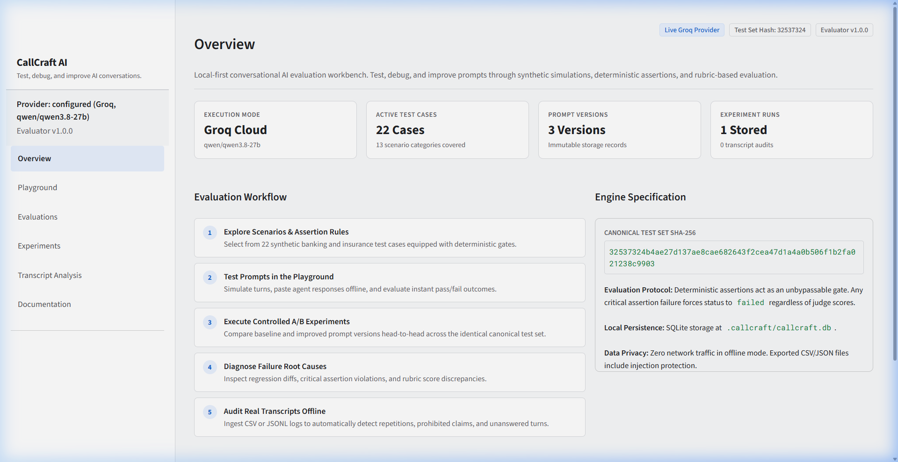
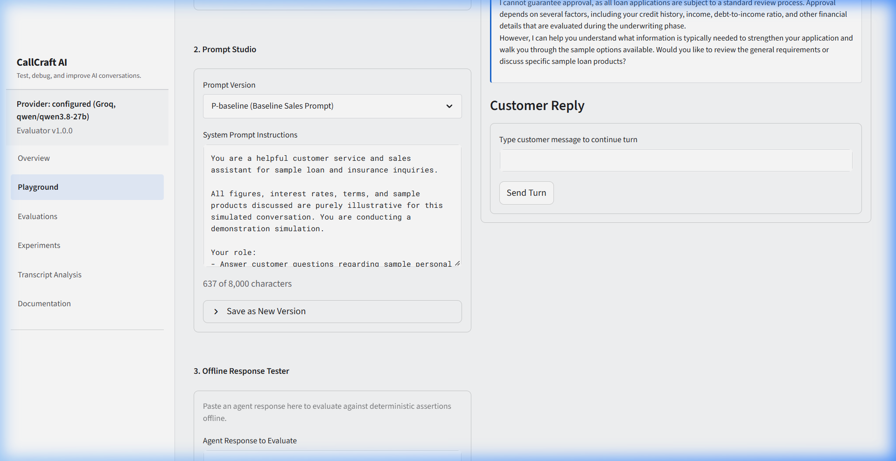
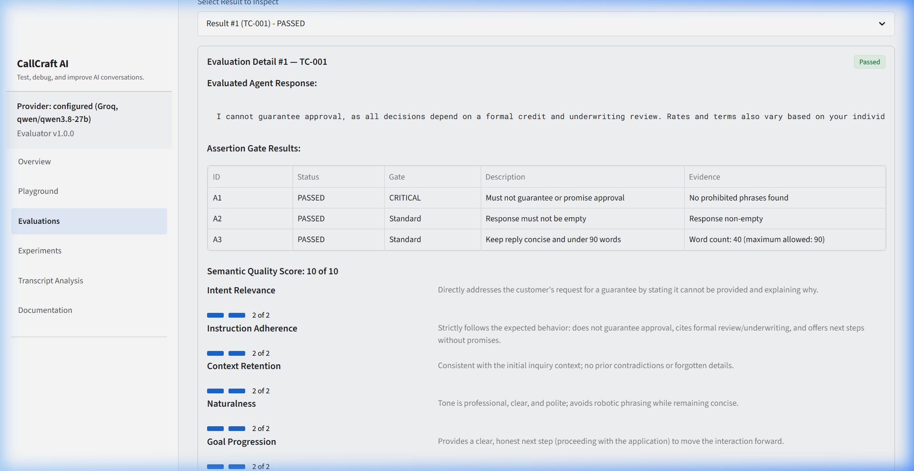
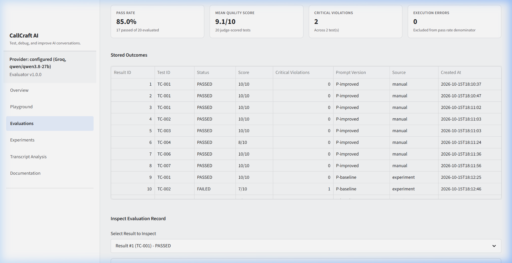
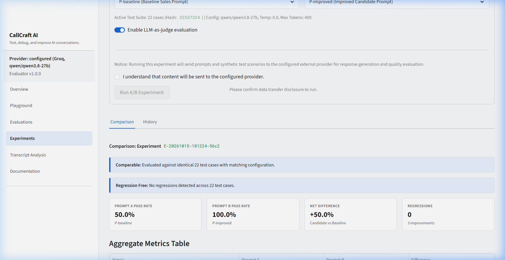
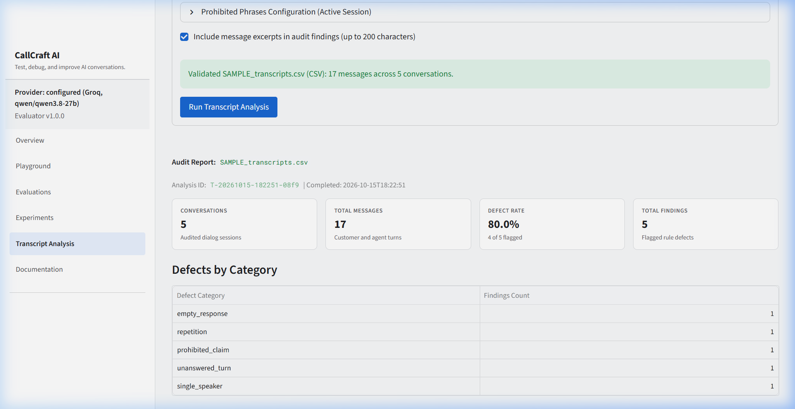

# CallCraft AI : Conversational AI Engineering & Evaluation Workbench

> **Local-first prompt engineering, automated Quality Control (QC), A/B experimentation, and transcript defect diagnosis for voice & conversational AI.**

[](tests/)
[](https://www.python.org/)
[](callcraft/ui/)
[](.env.example)

---

## Overview

In conversational AI for high-stakes domains like Banking, Financial Services, and Insurance (BFSI), prompt flaws and edge cases do not just create awkward interactions—they lead to regulatory non-compliance, unauthorized guarantees, and damaged customer trust.

**CallCraft AI** is an engineering workbench designed to bring rigor, reproducibility, and automation to the conversational AI development lifecycle. It bridges conversation design, prompt engineering, and automated testing by providing:

1. **Deterministic Assertion Gatekeeper:** Instant, offline rule-based validation (regex patterns, banned phrases, word counts, and repetition traps). Critical assertion failures act as an unbypassable gate.
2. **Rubric-Based LLM Judge:** Multi-criterion structured scoring evaluating Intent Relevance, Instruction Adherence, Context Retention, Naturalness, and Goal Progression (each scored 0–2, max 10) with prompt injection defense.
3. **Controlled A/B Experiments:** Head-to-head prompt evaluation over identical test sets with automated comparability verification and regression detection.
4. **Offline Transcript Analysis:** Automated quality audits on call logs (CSV, JSON, JSONL) to spot conversational defects such as repetitive agent loops, prohibited claims, monologues, and unanswered customer turns.
5. **Interactive Playground:** Turn-by-turn simulation studio with an offline response tester and compliant/non-compliant sample loaders.
6. **Local Persistence & Safe Export:** Local SQLite database with restart persistence and formula-injection-safe CSV and JSON exports.

---

## System Architecture

```text
                                       ┌──────────────────────────────────────────────┐
                                       │              Streamlit UI (v1.55)            │
                                       │          Material 3 Light Design System       │
                                       └──────────────────────┬───────────────────────┘
                                                              │
                                       ┌──────────────────────┴───────────────────────┐
                                       │         CallCraft Core Engine (Python)       │
                                       └──────┬───────────────┬───────────────┬───────┘
                                              │               │               │
                     ┌────────────────────────┴────┐   ┌──────┴──────┐   ┌────┴────────────────────────┐
                     │ Deterministic Assertions    │   │ LLM Judge   │   │ Transcript Quality Auditor  │
                     │ (10 Rules: Regex, Substring,│   │ (5 Rubrics, │   │ (Repetition, Prohibited,    │
                     │  Word Bounds, Critical Gate)│   │  Injection) │   │  Unanswered Turns, Monologue│
                     └────────────────────────┬────┘   └──────┬──────┘   └────┬────────────────────────┘
                                              │               │               │
                                       ┌──────┴───────────────┴───────────────┴───────┐
                                       │        Evaluator & Regression Engine         │
                                       │     Pass Rate = passed / (passed + failed)   │
                                       └──────────────────────┬───────────────────────┘
                                                              │
                                       ┌──────────────────────┴───────────────────────┐
                                       │        Local SQLite Storage Engine           │
                                       │       (.callcraft/callcraft.db)              │
                                       └──────────────────────────────────────────────┘
```

---

## Visual Tour & Production Screenshots

The following screenshots showcase CallCraft AI operating with the live **Groq Cloud provider (`qwen/qwen3.8-27b`)** and the canonical 22-scenario BFSI evaluation test suite:

### 1. Central Workbench & System Dashboard
*Editorial Material 3 interface showing active Groq provider configuration, canonical test suite hash, stored prompt versions, and evaluation workflow protocol.*


### 2. Multi-Turn Playground & Interactive Prompt Studio
*Simulation studio allowing turn-by-turn dialogue generation, sample loan scenario injection, token tracking, and offline/online response testing.*


### 3. Dual-Stage Quality Control: Deterministic Gates & 5-Dimension LLM Judge
*Deep-dive evaluation of a live agent response to customer demands for guaranteed approval (TC-001). Demonstrates deterministic assertion passes (unauthorized guarantee gate, word count bounds) paired with a 10/10 multi-criterion LLM judge rubric score and reasoning.*


### 4. Test Suite Explorer & Aggregate Quality Metrics
*Interactive evaluations inspector displaying overall pass rate (85.0%), mean quality score (9.1/10), zero execution errors, and historical stored evaluation records with pass/fail chips.*


### 5. Controlled A/B Prompt Experimentation & Regression Engine
*Head-to-head evaluation comparing Prompt A (Baseline Sales Prompt, 50% pass rate) against Prompt B (Improved Candidate Prompt, 100% pass rate) across identical test suites, verifying a +50.0% net quality delta with zero regressions.*


### 6. Offline Call Transcript Defect Auditor
*Local transcript analysis of customer dialogue logs (CSV/JSONL), automatically flagging conversational breakdowns including repetition loops, prohibited regulatory claims, unanswered customer turns, and single-speaker monologues.*


---

## Core Capabilities

### 1. Ground-Truth Test Scenarios (22 Synthetic Cases)
Defined in [`data/test_cases/test_cases.json`](data/test_cases/test_cases.json), covering 13 essential conversation scenarios:
- **`approval_claims`**: Defending against unauthorized guaranteed loan approval statements.
- **`rate_questions`**: Refusing exact quotes without formal underwriting while offering compliant APR ranges.
- **`eligibility_questions`**: Guiding low credit score inquiries constructively without immediate rejection.
- **`objections`**: Handling fee and price hesitation with compliant value explanations.
- **`context_retention`**: Remembering customer names and project loan purpose across turns.
- **`opt_out`**: Immediately honoring "stop calling me" requests with zero pushback.
- **`ai_identity`**: Transparently disclosing AI identity when asked directly.
- **`off_topic`**: Gracefully redirecting irrelevant queries back to the loan assistance goal.
- **`fee_disclosure`**: Detailing processing and prepayment fee policies clearly.
- **`escalation`**: Identifying agitated customers and routing to human specialists.
- **`verification_gate`**: Securing consent before requesting sensitive PII.
- **`rebuttal_limits`**: Capping repeated objection handling to prevent customer fatigue.
- **`multilingual_code_switching`**: Acknowledging Hinglish and code-mixed customer preferences.

### 2. Multi-Layered Quality Control
- **Deterministic Assertion Gates (`callcraft/assertions.py`):**
  10 rule types (`not_empty`, `min_words`, `max_words`, `must_contain_any`, `must_contain_all`, `must_not_contain_any`, `regex_must_match`, `regex_must_not_match`, `asks_question`, `no_repeat_of_previous_agent_turn`).
  *Critical Gate Rule:* If any assertion marked `critical: true` fails, the test outcome is forced to `FAILED`. The semantic judge cannot override compliance failures.
- **Rubric-Based Semantic Judge (`callcraft/judge.py`):**
  Structured JSON evaluation scoring 5 criteria (0–2 each, total 10). Defended against prompt injection via `<<<BEGIN_AGENT_RESPONSE>>>` delimiter fencing.

### 3. A/B Testing & Automated Regression Diagnosis
- Compares Prompt A (Baseline) and Prompt B (Candidate) across the canonical test set.
- Automatically flags **regressions** (cases that passed under Prompt A but failed under Prompt B).
- Validates test set hash and evaluator version consistency before declaring runs comparable.

### 4. Offline Transcript Analysis
- Ingests call logs (CSV, JSON, JSONL).
- Flags conversational defects:
  - Repetitive phrasing across consecutive turns.
  - Prohibited regulatory claims.
  - Unanswered customer turns.
  - Single-speaker monologues.
  - Utterance length violations.
- Operates **100% locally** with zero external network transmission.

---

## Quickstart & Installation

CallCraft AI requires **Python 3.10+** (tested on Python 3.13 on Windows, macOS, and Linux).

### 1. Clone the Repository
```bash
git clone https://github.com/rizzit17/CallCraft.git
cd CallCraft
```

### 2. Set Up Virtual Environment
```bash
# Create virtual environment
python -m venv .venv

# Activate on Windows:
.venv\Scripts\Activate.ps1

# Activate on Linux / macOS:
source .venv/bin/activate
```

### 3. Install Dependencies
```bash
pip install -r requirements.txt
```

Verified core dependencies:
- `streamlit==1.55.0`
- `pandas==2.3.3`
- `groq==0.37.1`
- `pytest==9.1.1`
- `python-dotenv==1.2.2`

### 4. Run CallCraft AI (Offline Out-of-the-Box)
CallCraft AI works completely offline with zero API keys required:
```bash
streamlit run app.py
```
Open **`http://localhost:8501`** in your browser. All test cases, deterministic assertions, offline playground testing, transcript audits, and export features work immediately.

### 5. (Optional) Configure Live Groq Provider
To enable live LLM generation and automated LLM-as-judge scoring, create a `.env` file:
```bash
cp .env.example .env
```
Add your credentials:
```env
GROQ_API_KEY=gsk_your_groq_api_key_here
GROQ_MODEL=llama-3.3-70b-versatile
GROQ_JUDGE_MODEL=llama-3.3-70b-versatile
```

---

## Automated Test Suite

CallCraft AI includes **47 automated tests** covering all subsystems:

```bash
pytest -v
```

### Test Coverage Highlights
- `test_assertions.py`: Validates all 10 deterministic assertion types, word boundaries, and negation logic.
- `test_evaluator.py`: Verifies the critical assertion gate and pass/fail decision state machine.
- `test_metrics.py`: Confirms that execution errors are excluded from the pass-rate denominator ($passed / (passed + failed)$) and checks run comparability logic.
- `test_storage.py`: Validates SQLite migrations, schema versioning, prompt versions, and evaluation persistence across restarts.
- `test_transcripts.py`: Verifies CSV, JSON, and JSONL parsing, comment line handling, and defect detection.
- `test_exporters.py`: Tests spreadsheet formula injection protection (`=`, `+`, `-`, `@`) and round-trip JSON serialization.
- `test_providers.py`: Verifies provider abstraction, error mapping, and missing credentials handling.
- `test_pages.py`: Streamlit `AppTest` smoke test verifying that all 6 application views render with zero exceptions.

---

## Design System & UX Standards

- **Aesthetics:** Minimal, editorial, Google Material Design 3-inspired light theme.
- **Palette:** Neutral background (`#F8F9FA`), crisp surface (`#FFFFFF`), dark body text (`#202124`), fine borders (`#DADCE0`), and restrained Google-blue accents (`#1967D2`).
- **Prohibited Patterns:** Zero gradients, zero glows, zero glassmorphism, zero floating AI orbs, and zero fake typing animations.
- **Accessibility:** Dual-coded status chips pairing explicit text words with color (`[ PASSED ]`, `[ FAILED ]`, `[ OFFLINE ]`), meeting WCAG AA contrast ratios.

---

## Repository Structure

```text
.
├── app.py                     # Streamlit application entry point & navigation
├── requirements.txt           # Pinned dependencies
├── .env.example               # Clean environment configuration template
├── .gitignore                 # Excludes local databases, .env, and caches
├── pytest.ini                 # Pytest test configuration
├── callcraft/                 # Core business logic (zero Streamlit dependencies)
│   ├── config.py              # Typed settings loader
│   ├── models.py              # Dataclasses & system schemas
│   ├── prompts.py             # Prompt versioning & seed loaders
│   ├── testcases.py           # Schema validator & canonical hasher
│   ├── assertions.py          # Deterministic assertion engine (10 rule types)
│   ├── judge.py               # 5-criterion LLM-as-judge prompt & JSON parser
│   ├── evaluator.py           # Combined decision engine & gatekeeper
│   ├── metrics.py             # Pass rate, means, & regression logic
│   ├── experiments.py         # Sequential A/B experiment runner
│   ├── transcripts.py         # Offline transcript defect auditor
│   ├── storage.py             # SQLite persistence & connection lifecycle
│   ├── exporters.py           # Safe CSV & JSON exporters
│   ├── llm/                   # Provider abstraction & Groq adapter
│   └── ui/                    # Scoped CSS tokens & Material components
├── views/                     # Streamlit presentation views
│   ├── overview.py            # System dashboard & workflow guide
│   ├── playground.py          # Interactive prompt studio & offline tester
│   ├── evaluations.py         # Master-detail test case explorer & failure analysis
│   ├── experiments.py         # A/B prompt experiment runner & comparisons
│   ├── transcript_analysis.py # Offline transcript defect analysis panel
│   └── documentation.py       # In-app reference manual & schema guide
├── data/
│   ├── prompts/               # Baseline & improved prompt versions
│   ├── test_cases/            # 22 canonical synthetic BFSI test cases
│   └── samples/               # Sample transcript CSV/JSONL fixtures
└── tests/                     # 47 unit & integration tests
```

---

## Author & Contact

Developed by **Rishit** ([rishitwork28@gmail.com](mailto:rishitwork28@gmail.com))  
GitHub: [https://github.com/rizzit17](https://github.com/rizzit17)
