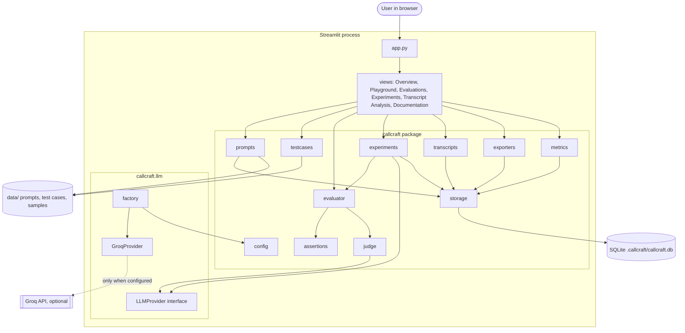
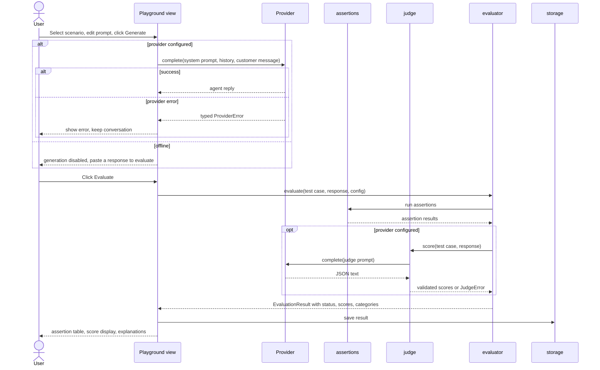
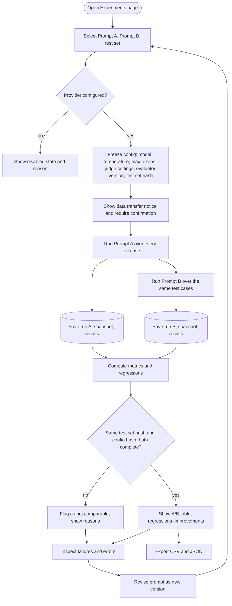

# CallCraft AI: Architecture

This file owns technical structure. Detailed behaviour and schemas are in `systemdesign.md`. Product scope is in `prd.md`. Decisions and their verification status are in `decisions.md`.

## 1. Architecture summary

A single-process Python application. Streamlit renders the UI. All logic lives in a `callcraft/` package that does not import Streamlit, so it can be tested without a browser. SQLite stores results. An `LLMProvider` interface isolates the model vendor. Everything except generation and judging works offline.

| Layer | Technology | Notes |
|---|---|---|
| Language | Python 3.10 or newer | Verify the installed version |
| UI | Streamlit | Pages in `views/`, navigation through `st.navigation` if verified |
| Logic | Plain Python modules in `callcraft/` | No Streamlit imports |
| Tabular work | Pandas | Transcript analysis, metrics tables, exports |
| Persistence | SQLite via `sqlite3` | File at `.callcraft/callcraft.db` |
| LLM access | `groq` SDK behind `LLMProvider` | Optional, configured by environment |
| Configuration | Environment variables, optional `.env` | Loaded with `python-dotenv` |
| Tests | pytest | `FakeProvider` for provider-dependent paths |

## 2. Component responsibilities and boundaries

| Component | Module | Responsibility | Must not |
|---|---|---|---|
| Entry point | `app.py` | Configure page, inject theme, register pages, show provider status | Contain business logic |
| Views | `views/*.py` | Render one page each, call logic functions, hold UI state in `st.session_state` | Talk to SQLite or the SDK directly |
| Config | `callcraft/config.py` | Read environment, expose a typed `Settings`, never print secrets | Raise on missing keys, since offline mode is valid |
| Models | `callcraft/models.py` | Dataclasses for prompts, test cases, assertions, results, runs | Perform I/O |
| Prompts | `callcraft/prompts.py` | Load seed prompts, create versions, generate IDs, snapshot | Call the provider |
| Test cases | `callcraft/testcases.py` | Load, validate, hash, and filter test cases | Mutate files silently |
| Assertions | `callcraft/assertions.py` | Deterministic checks returning typed results | Call the provider |
| Judge | `callcraft/judge.py` | Build judge prompt, call provider, parse and validate JSON | Decide pass or fail |
| Evaluator | `callcraft/evaluator.py` | Combine assertion results and judge output into a status | Hide errors |
| Metrics | `callcraft/metrics.py` | Compute metrics and regressions from result rows | Read from the UI |
| Experiments | `callcraft/experiments.py` | Run A and B over the test set, record runs, enforce comparable config | Compare incomparable runs silently |
| Transcripts | `callcraft/transcripts.py` | Parse, validate, group, analyse uploaded transcripts | Send data externally |
| Storage | `callcraft/storage.py` | Create schema, read and write rows, migrations by version check | Swallow database errors |
| Exporters | `callcraft/exporters.py` | Turn stored rows into CSV and JSON bytes | Recompute metrics differently from `metrics.py` |
| LLM layer | `callcraft/llm/` | `base.py` interface and error types, `groq_provider.py`, `factory.py` | Contain evaluation logic |
| UI helpers | `callcraft/ui/` | CSS theme string, small render helpers (status chips, score bars) | Contain business logic |

Dependency direction: `views` to `callcraft` logic to `storage` and `llm`. Logic modules never import from `views` or `ui`. `models.py` and `config.py` import nothing from the rest of the package.

## 3. Repository structure

```text
.
├── app.py
├── requirements.txt
├── README.md
├── .env.example
├── .gitignore
├── .streamlit/
│   └── config.toml
├── masterprompt.md
├── architecture.md
├── context.md
├── systemdesign.md
├── prd.md
├── design.md
├── precaution.md
├── decisions.md
├── callcraft/
│   ├── __init__.py
│   ├── config.py
│   ├── models.py
│   ├── prompts.py
│   ├── testcases.py
│   ├── assertions.py
│   ├── judge.py
│   ├── evaluator.py
│   ├── metrics.py
│   ├── experiments.py
│   ├── transcripts.py
│   ├── storage.py
│   ├── exporters.py
│   ├── llm/
│   │   ├── __init__.py
│   │   ├── base.py
│   │   ├── groq_provider.py
│   │   └── factory.py
│   └── ui/
│       ├── __init__.py
│       ├── theme.py
│       └── components.py
├── views/
│   ├── overview.py
│   ├── playground.py
│   ├── evaluations.py
│   ├── experiments.py
│   ├── transcript_analysis.py
│   └── documentation.py
├── data/
│   ├── prompts/
│   │   ├── baseline.txt
│   │   └── improved.txt
│   ├── test_cases/
│   │   └── test_cases.json
│   └── samples/
│       ├── SAMPLE_transcripts.csv
│       └── SAMPLE_transcripts.jsonl
├── tests/
│   ├── conftest.py
│   ├── test_testcases.py
│   ├── test_assertions.py
│   ├── test_evaluator.py
│   ├── test_metrics.py
│   ├── test_regressions.py
│   ├── test_experiments.py
│   ├── test_storage.py
│   ├── test_transcripts.py
│   ├── test_exporters.py
│   └── test_providers.py
└── .callcraft/            (created at runtime, git-ignored)
```

If the workspace already contains code when implementation starts, inspect it and reuse what fits this structure. Record any deviation in `decisions.md`.

## 4. High-level component architecture



## 5. Request and evaluation flow



## 6. Prompt experiment workflow



## 7. Data flow

1. At startup, `prompts.py` and `testcases.py` load seed files from `data/`, validate them, and mirror them into SQLite if not present. Validation failures stop the affected page with a clear message.
2. Playground input goes to the provider through `LLMProvider`. The reply is evaluated and may be saved.
3. Experiments loop over test cases, generate, evaluate, and write one `evaluation_results` row per test and run.
4. `metrics.py` reads result rows and computes every number the UI shows.
5. Transcript uploads are parsed in memory, validated, analysed, and the findings (not the raw file) are stored by default. Raw transcript text is stored only if the user ticks a visible option.
6. Exports read stored rows and serialise them.

## 8. External dependencies

| Dependency | Purpose | Required |
|---|---|---|
| streamlit | UI | Yes |
| pandas | Tables, CSV handling | Yes |
| python-dotenv | Load `.env` | Yes |
| groq | Groq SDK | Optional at runtime, installed by default |
| pytest | Tests | Development |
| Google Fonts (Roboto) | Typography when online | No, fallback stack used offline |

Versions are pinned in `requirements.txt` only after installing and running. Network access is needed only for the Groq API and optional font loading.

## 9. Storage strategy

- SQLite for prompt versions, test cases, experiment runs, evaluation results, and transcript analyses (schemas in `systemdesign.md` section G).
- JSON files in `data/` for seed prompts and test cases, treated as source seeds.
- Schema version stored in a `meta` table. A mismatch produces a clear message and does not auto-delete data.
- Writes use transactions. Results for a run are written per test so partial runs survive interruption.
- `.callcraft/` is git-ignored.

## 10. Error-handling strategy

- Provider layer raises typed errors: `MissingCredentialsError`, `ProviderTimeoutError`, `RateLimitError`, `AuthenticationError`, `InvalidResponseError`, `ProviderError` (base).
- Experiments catch provider errors per test, store them as `status = error` with the error type and message, and continue.
- Judge failures set `judge_status = error` and never produce scores.
- Parsers return structured validation errors (file, row, field, message).
- Views display errors with plain text and a suggested action. No error becomes a success state.
- Storage errors surface to the user and stop the write. There is no silent in-memory fallback.
- Full table of cases in `systemdesign.md` section I.

## 11. Security boundaries

- Secrets only in environment variables or untracked `.env`. `Settings` exposes only whether a key is present, never the key.
- Uploaded files are untrusted: size and row limits, schema validation, plain-text rendering, no `unsafe_allow_html` on user content.
- The only outbound data path is `GroqProvider`, invoked only after explicit user action and a visible disclosure.
- No telemetry. No credentials in logs or exports.
- Synthetic data only in the repository.

## 12. Testing strategy

- Unit tests for assertions, evaluator truth table, metrics, regression logic, storage round trips, transcript validation, exporters, and provider error mapping.
- `FakeProvider` in `tests/conftest.py` returns scripted responses and raises scripted errors. It exists only in tests.
- Experiment tests use `FakeProvider` to verify identical configuration, error exclusion from pass rate, and incomplete-run handling.
- Exports are re-imported and compared to stored rows.
- Optional Streamlit `AppTest` smoke tests per page if the installed version supports them.
- Live provider checks run only when a key exists. Otherwise they are reported as blocked.
- Command: `pytest -q` from the repository root.

## 13. Deployment strategy

Local execution is the supported target:

```text
python -m venv .venv
pip install -r requirements.txt
cp .env.example .env
streamlit run app.py
```

Deployment is optional and not part of completion. If attempted (for example on Streamlit Community Cloud), secrets go in the host's secret store, and a URL is reported only after the live app has been opened and verified. Otherwise the report states "not deployed".
